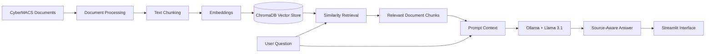

# CyberMACS RAG Mentor

A public showcase of a team-built Retrieval-Augmented Generation (RAG) assistant developed as part of the CyberMACS Erasmus Mundus programme.

> The application source code is maintained in a private team repository and is intentionally not included here. This repository documents the project's architecture, technical approach, and outcomes.

## Overview

CyberMACS RAG Mentor is a local question-answering assistant designed to retrieve relevant information from programme-specific documents and generate source-aware responses.

The system combines semantic retrieval with local large-language-model inference, allowing users to query a curated document collection without relying entirely on a model's pre-existing knowledge.

## Key Highlights

- Built over **4,680 embedded document chunks**
- Local vector search using **ChromaDB**
- Local LLM inference using **Ollama**
- **Llama 3.1** used for response generation
- Retrieval workflow implemented with **LangChain**
- Interactive interface built with **Streamlit**
- Source-aware responses grounded in retrieved document context
- Runs locally without requiring a cloud-hosted language model

## Architecture

## Retrieval Pipeline

Documents were divided into chunks before being embedded and stored in the vector database.
## Retrieval Pipeline
Documents were divided into chunks before being embedded and stored in the vector database.

The implementation used:
- Chunk size: 500 characters
- Chunk overlap: 50 characters
- Similarity retrieval: top k = 10
- Vector database: ChromaDB
  
When a user submits a question, the system:
1. Converts the question into a representation suitable for semantic search.
2. Retrieves the most relevant document chunks from ChromaDB.
3. Supplies the retrieved context together with the question to the local language model.
4. Generates an answer grounded in the retrieved CyberMACS material.
5. Presents the response through the Streamlit interface.
   
Technology Stack
- Python
- Streamlit
- LangChain
- ChromaDB
- Ollama
- Llama 3.1
  
Why RAG?

Large language models can generate convincing answers even when they do not have reliable information about a specific organization, programme, or private knowledge base.
Retrieval-Augmented Generation addresses this by combining language-model generation with information retrieved from a controlled document collection.
For this project, the RAG approach enabled the assistant to answer questions using CyberMACS-specific material rather than relying only on general model knowledge.

**Project Scope**

The project explored:
- Document ingestion and preprocessing
- Text chunking
- Embedding and vector storage
- Semantic similarity search
- Retrieval configuration
- Prompt-context construction
- Local LLM inference
- Source-aware answer generation
- User-interface development
  
**Team Project**

This project was developed collaboratively as part of the CyberMACS programme.
The original implementation remains in a private team repository. This public repository exists only to present the architecture, technical approach, and project outcomes without exposing the team's private source code.

**Screenshots**

Screenshots of the application will be added here to demonstrate the user interface and retrieval workflow.

Author
Bimbo Lawrence Damitan
Applied Cybersecurity MSc candidate at SRH Berlin
- Portfolio: https://lawrenceabim.com/
- LinkedIn: https://www.linkedin.com/in/bimbo-lawrence/
